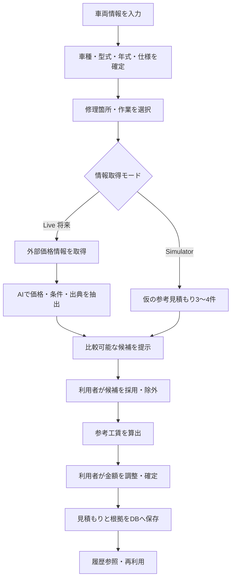

# 自動車整備工賃見積もりアプリ 要件定義書

- 文書版数: 0.1（プロトタイプ）
- 作成日: 2026-10-11
- 状態: 開発用ドラフト（仕様・外部API利用条件は実装時に再確認）

## 1. プロジェクト概要

日本国内の自動車を中心に、**車種・型式（例: FL4）・年式などの車両情報と修理箇所**を入力すると、公開されている整備業者の料金情報や蓄積データを参考に、**概算候補を3〜4件提示**するWebアプリを開発する。最終金額は利用者が確認・修正して確定し、今後の見積もりに活用できるよう自作データベースに保存する。

初期版は **Simulator（シミュレーター）モード**で完成させる。外部APIに未接続でも、車両選択から見積もり確定・DB保存まで一連の操作を実際に行えることを目指す。

### 1.1 目的
- 車両情報の入力と修理内容の選択を簡単にする。
- 複数の料金根拠を比較し、見積もり金額の決定を支援する。
- 確定した工賃・部品代などを記録し、次回の見積もり作成を効率化する。
- 将来的に実車データAPI、AIによるWeb調査、見積書出力に拡張する。

### 1.2 想定利用者
- 自動車整備工場のスタッフ、見積もり担当者
- 初期版はデモ・検証用途。**商用利用可能な精度や料金データの網羅性は保証しない。**

## 2. 対象範囲と開発段階

### Phase 1: 最優先（動くSimulator版）
1. 車種名・型式による車両検索、年式・仕様の選択
2. 車両寸法などの基本情報表示（登録されている場合）
3. 修理カテゴリー／作業内容の選択
4. 仮の参考価格を3〜4件提示（架空データと明記）
5. 比較対象の採用／除外、工賃候補値の算出、手動修正
6. 工賃・部品代・税額・合計の表示
7. 確定見積もりと参照情報をSQLiteに保存・再表示
8. 参照データの出所表示（例: `simulator`）

### Phase 2: 実データの導入
1. NHTSA Vehicle APIに対応（対応VINのみ）
2. 国土交通省の電子車検証関連APIの導入可否を調査し、申請・利用条件に従って連携
3. Web公開料金情報の検索・収集（取得可能なページ、利用規約・robots等に配慮）
4. Gemini API等による本文からの価格・条件抽出、根拠の整理
5. 根拠URL、取得日、車両適合度、金額区分の表示
6. 情報不足時の警告と手動入力へのフォールバック

### Phase 3: 拡張
- PDF・印刷用見積書、履歴検索、既存見積もりの再利用
- 車両・作業データの拡充、整備工場ごとの工賃単価設定
- 承認履歴、データ更新管理、ユーザー管理
- 利用許諾を得た標準作業時間・部品価格データとの連携

## 3. 基本業務フロー

## 4. 機能要件

### F-01 車両検索・選択
- **車種名**（例: シビック）または**型式**（例: FL4）を入力する。
- 部分一致検索で候補を表示する。
- メーカー、車種、型式、年式、グレード／仕様（必要な場合）を選択する。
- 全長・全幅・全高、原動機／駆動方式など登録済み情報を表示する。
- 型式のみでは年式・仕様を一意に特定できない場合があるため、追加選択を必須とする。
- **型式（FL4等）と車台番号・17桁VINは別の識別子**として扱う。
- 車両情報が見つからない場合、手入力して暫定登録できる。

### F-02 修理内容の選択
- カテゴリー例: エンジン、ブレーキ、足回り、電装、外装、消耗品。
- 作業例: エンジンオイル交換、フロントブレーキパッド交換、補機バッテリー交換。
- 前後左右、部品の有無・仕様、同時作業など金額を左右する条件を入力可能にする（初期版は簡易入力）。
- 複数作業の登録を想定する。ただし重複工程の自動控除は初期版の対象外。

### F-03 参考価格候補の取得・表示
- 1作業につき原則3〜4件の候補を表示する。
- 候補ごとに、金額、工賃／部品代／総額の区分、税込・税抜、車両一致度、作業条件、情報源、参照日を保持する。
- Simulatorでは固定の架空レコードを返し、必ず「サンプル／実価格ではない」と明記する。
- Liveでは公開された価格情報が十分な場合のみ候補を提示し、不足時に**無理に3〜4件へ水増ししない**。
- 出典URLや価格の捏造を禁止する。
- 比較条件が著しく異なる候補は注意表示する。

### F-04 AIによる情報整理（将来）
- AIの役割は**実在する参照情報からの価格・条件・出典の抽出と分類**とする。
- Web検索そのものが必要な場合は、検索機能／検索APIと組み合わせる。Gemini APIへの単純な文章入力だけで最新ブログを自動参照できると想定しない。
- 取得できない項目は `null` や「不明」とする。
- AI出力はJSONスキーマで検証し、URL・金額・通貨・区分・車種適合をアプリ側でもチェックする。
- AIによる架空の相場推定を実際の調査結果と混同しない。

### F-05 参考金額の算出・確定
- ユーザーが各候補を採用／除外できる。
- 初期版の参考工賃は**採用した工賃候補の中央値**とする（候補数1件ならその値）。
- 部品代は工賃と分離して評価し、工賃・部品代・税込総額を混ぜて中央値を計算しない。
- 採用候補が0件なら自動算出不可とし、手入力へ切り替える。
- 確定金額は利用者が手動修正でき、最終決定権は利用者に置く。
- 修正前の算出値、修正後の確定値、採用根拠を保存する。
- 初期版の消費税は10%を設定値として計算し、端数処理ルールをコード側で統一する（例: 税額の円未満切り捨て）。
- **概算表示は正式な修理費用の保証ではない**ことを明記する。

### F-06 DB保存・再利用
- 車両・作業・候補出典・確定見積もりを関連づけて保存する。
- 既存見積もりを車種・型式・年式・作業で検索する。
- 同じ型式でも年式・グレード・作業条件が違う場合は別条件として扱う。
- 保存済み金額を再利用する際は、最終更新日と当時の条件を表示する。
- DB登録は実際にバックエンドで永続化し、ブラウザ再読み込み後も残ること。

## 5. 外部サービス・データ源

| 情報源 | 目的 | 初期版の扱い | 注意点 |
|---|---|---|---|
| 自作車両JSON | 車種・型式・年式・寸法 | 使用 | 公式カタログ等を参照し、出典と確認日を記録 |
| NHTSA vPIC API | VINから車両情報取得 | アダプターのみ／後日接続 | 主に17桁VIN対象。国内の型式 `FL4` を検索するAPIではない。日本仕様の年式・寸法を保証しない |
| 国土交通省 電子車検証関連API | 車検証記載データの取得 | 後日検討 | 車台番号／型式だけで自由に全国の車両を検索する汎用APIではない。申請、認証、読み取り要件を要確認 |
| Gemini API等 | 価格の情報抽出・整形 | Simulatorで代替 | モデルごとに無料枠、検索連携料金・制限、利用条件を確認 |
| 整備業者の公開サイト・ブログ | 修理費用の参考価格 | 仮データで代替 | 規約・著作権・アクセス制限・情報の鮮度に注意 |
| 自作SQLite DB | 車両・作業・出典・見積もり保存 | 使用 | データの整合性・バックアップを考慮 |

外部APIの料金・無料枠・仕様は変更されるため、接続実装直前に公式資料で確認する。

## 6. データモデル（案）

### `vehicles`
- `id`、`maker`、`model`、`model_code`（例: FL4）
- `year_from`、`year_to`、`grade`、`powertrain`
- `length_mm`、`width_mm`、`height_mm`
- `source_name`、`source_url`、`verified_at`

### `repair_jobs`
- `id`、`category`、`name`、`position`（前後左右等）
- `description`、`required_conditions`

### `price_sources`
- `id`、`vehicle_id`、`repair_job_id`、`mode`（simulator/live/manual）
- `source_title`、`source_url`、`published_at`、`retrieved_at`
- `labor_price`、`parts_price`、`total_price`、`tax_included`
- `vehicle_match_level`、`work_conditions`、`extraction_notes`
- `verified`、`currency`（原則JPY）

### `estimates`
- `id`、`vehicle_id`、`created_at`、`status`
- `calculated_labor_price`、`final_labor_price`、`final_parts_price`
- `tax_amount`、`total_amount`、`hourly_rate`（任意）
- `selected_source_ids`（実装では中間テーブル推奨）
- `manual_adjustment_reason`、`notes`

### `estimate_items`（複数作業対応）
- `id`、`estimate_id`、`repair_job_id`、`quantity`
- `labor_price`、`parts_price`、`notes`

本格実装では価格候補と見積もりの多対多関係を別テーブルで正規化する。

## 7. 技術構成

| 区分 | 技術 |
|---|---|
| フロントエンド | React + TypeScript + Tailwind CSS |
| バックエンド | FastAPI (Python) |
| DB | SQLite（将来的にPostgreSQL等へ移行可） |
| 開発データ | JSON / SQLite初期投入データ |
| 外部AI連携 | Gemini API等をバックエンド経由で利用 |
| 動作環境 | PCブラウザを優先、レスポンシブ対応 |

### API境界（初期案）
- `GET /api/vehicles?query=FL4`：車両検索
- `GET /api/vehicles/{id}`：車両詳細
- `GET /api/repair-jobs`：修理項目一覧
- `POST /api/price-research`：Simulator／Liveの参考価格候補取得
- `POST /api/estimates`：見積もり確定・保存
- `GET /api/estimates/{id}`：見積もり詳細
- `GET /api/estimates`：見積もり履歴

`price-research` のモード切替はバックエンドで処理し、フロントエンドから同じ形式の結果を扱えるようにする。APIキーはサーバーの環境変数に保管し、ブラウザへ公開しない。

## 8. UI・UX要件

- 画面遷移を **「車両選択 → 作業選択 → 参考金額比較 → 金額確定 → 保存」** に整理。
- 検索ボックスは車種名・型式の両方に対応。
- 修理カテゴリーは分かりやすい日本語ラベルで表示。
- 比較候補をカード形式で3〜4件表示し、採用／除外が簡単にできる。
- 工賃・部品代・消費税・総額は明確に分ける。
- 金額確定時、修正可能な入力欄と保存ボタンを用意。
- デモモードであること、仮データであることを常時分かるようにする。
- 将来的に車両イラスト上で修理箇所を選ぶ機能を検討（初期版必須ではない）。

## 9. 非機能要件・注意事項

- **正確性**: 車両の型式だけでグレードや仕様を推定確定しない。車両寸法だけで部品の適合性や工賃を判断しない。
- **透明性**: 参考価格ごとに根拠・取得日時・一致条件を表示する。
- **安全性**: APIキーをフロントに埋め込まない。入力値検証とバックエンドでの再計算を実施。
- **個人情報**: デモではナンバープレート、所有者、完全な車台番号等の個人情報を原則保存しない。
- **法務**: 外部サイトの全文無断転載、大量スクレイピング、許可のない有料データ組み込みを避ける。
- **運用**: AIが取得に失敗してもSimulatorや手動登録で作業を継続できる。
- **性能**: ローカルデモで車両検索・工賃再計算が快適に動くこと。
- **再現性**: Simulatorの入力が同じなら同じ候補・金額を返す。

## 10. 初期サンプルデータ

車両候補例:
- ホンダ シビック: FL1 / FL4
- トヨタ プリウス: ZVW50 / MXWH60
- トヨタ アクア: NHP10 / MXPK11
- スズキ ジムニー: JB64W
- ホンダ N-BOX: JF3 / JF5

修理候補例:
- フロントブレーキパッド交換
- エンジンオイル交換
- 補機バッテリー交換
- エアコンフィルター交換
- フロントバンパー交換

※登録する具体的な年式範囲・諸元はメーカー資料で要確認。Simulatorの工賃と部品代は架空値として扱う。

## 11. MVPの受け入れ基準

- [ ] `FL4` または `シビック` で車両候補を検索できる。
- [ ] 年式／仕様を選択でき、車両情報を確認できる。
- [ ] `フロントブレーキパッド交換` を選択できる。
- [ ] Simulatorが架空の参考価格を3〜4件返し、架空データと表示する。
- [ ] 各候補の工賃・部品代の区別が明確である。
- [ ] 候補を採用・除外すると参考工賃が再計算される。
- [ ] 金額を手動修正し、消費税・合計を計算できる。
- [ ] 確定した見積もりをSQLiteに保存できる。
- [ ] ページ更新後も保存データを参照できる。
- [ ] 外部APIキーなし・外部通信なしでも一連のデモが動く。

## 12. 現時点での未確定事項

1. 部品代を参考価格から自動採用するか、初期値は手入力中心にするか。
2. 修理作業を初期版から複数同時選択させるか。
3. 工場独自の時間単価と標準作業時間をいつ導入するか。
4. Liveモードにおける料金サイトの検索手段と許諾・アクセス条件。
5. 電子車検証APIの実際の導入要件と利用申請方法。
6. 本番運用時の認証・顧客管理・データ保管方針。

---

**開発方針の要約:** まずは「FL4入力 → 車両決定 → 修理箇所選択 → 架空の参考価格3〜4件比較 → 金額確定 → SQLite保存」を完成させ、データ取得アダプターを後からNHTSA・電子車検証関連API・Gemini＋検索基盤に置き換える。
