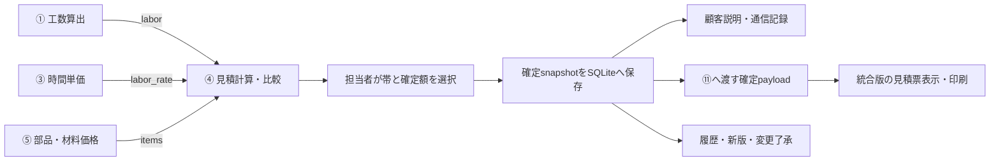

# 整備見積システム 統合版設計・利用ドキュメント

作成日：2026-10-11

対象実装：`src/auto_repair_quote/`（実装コミット `c2d7c4c`）

設計元：[金額計算・内訳表示の30案](auto-repair-quote-ideas-30.md)

## 1. 統合版の目的と範囲

工場の担当者が、作業条件から金額の幅を比較し、採用する条件と金額を判断して、顧客への説明・電話記録・見積票・過去履歴まで同じ見積版で追跡できるようにする。

30案の中から、設計書がMVPに推奨する **P01（工賃計算）＋P07（費目別内訳）＋P14（担当者確定）** を核にする。価格・単位の検証、条件表示、保存、通信台帳、帳票をその前後に接続し、比較・再開・追加変更は補助機能としてまとめた。

現在の実装は **架空データを使うSimulator**。工数算出エンジン・時間単価・部品材料価格を共通形式で受け取る境界を持つが、各独立システムとの自動接続は検証していない。ブラウザ印刷とJSON出力までを実装し、実価格の取得、認証、本番の請求書発行、実車試験、公開環境への配備は対象に含めていない。

以下の人時、単価、金額、税設定、日付、匿名IDはすべて架空例であり、相場や工場の合意済み価格ではない。

## 2. 採用した案と統合理由

| 役割 | 採用案 | 統合した内容 | 採用理由 |
| --- | --- | --- | --- |
| 作業選択 | P19・P20 | 承認済みプリセットと略称検索 | 電話中の入力量を減らす |
| 条件確認 | P03・P11・P22 | 単位・必須値の検証、条件・不足質問 | 不明値を0円にして提示することを防ぐ |
| 金額計算 | P01・P02・P04・P05・P06・P07・P09 | 請求人時、工程、品目、値引き、最低工賃、費目、税 | 同じ条件帯で計算し、調整の根拠を残す |
| 比較表示 | P08・P10・P23 | 3帯カード、価格の出所、帯ごとの条件差 | 金額の差を担当者が説明できる |
| 操作と確定 | P13・P14 | 入力から比較・確定への誘導、帯選択、理由付き調整 | 計算結果を自動で確定しない |
| 説明と記録 | P12・P18・P27・P28・P30 | 顧客要約、確定snapshot、通信台帳、帳票データ | 伝えた額と保存・印刷した額を一致させる |
| 中断・変更 | P15・P17・P21・P26・P29 | 新版、下書き、履歴、差分、顧客了承 | 再見積でも旧版と伝達条件を失わない |
| 補助比較 | P16・P24・P25 | 登録条件での電話概算、価格比較、複数作業比較 | 必要な場面だけで使う |

30案を独立した画面に分割せず、通常操作は「入力 → 比較 → 確定 → 説明」に集約する。履歴・下書き・追加変更・比較ツールは補助パネルから開く。

電話概算は登録条件がそろう場合だけ利用する。複数作業の統合比較は、重複費目の候補を確認するための機能であり、材料や工程を自動で控除しない。

## 3. 全体構成と5システムの接続境界



図の①・③・⑤・⑪は接続境界を示す。現在の統合版は①・③・⑤の値を架空fixtureから読み、⑪向けのpayloadと見積票を生成する。各独立実装をこの図の通りに自動呼び出ししているという意味ではない。

| 層 | 主なファイル | 責務 |
| --- | --- | --- |
| 画面 | [main.tsx](../../src/auto_repair_quote/main.tsx)、[models.ts](../../src/auto_repair_quote/models.ts)、[style.css](../../src/auto_repair_quote/style.css) | 入力、比較、帯選択、確定、説明、印刷 |
| 統合処理 | [workflow.py](../../src/auto_repair_quote/workflow.py) | 一度の試算から表示を組み立て、保存版から説明・帳票・同版イベントを取得 |
| 計算 | [pipeline.py](../../src/auto_repair_quote/pipeline.py)、`p01.py`〜`p30.py` | 各案の検証・計算・表示・記録処理 |
| HTTP境界 | [api.py](../../src/auto_repair_quote/api.py) | サーバー再計算、保存、通信・変更のトランザクション |
| 保存 | [store.py](../../src/auto_repair_quote/store.py) | SQLite、版の一意性、イベントの外部キー |
| 架空データ | [fixtures.py](../../src/auto_repair_quote/fixtures.py) | 人時・レート・品目・プリセットのデモ値 |

React・TypeScript・Tailwind CSSの画面と、FastAPI・SQLiteのバックエンドを使用する。ビルドした画面をAPIと同じサーバーから配信する。

## 4. 共通データと変数名

独自変数・APIキーは `snake_case` に統一する。帯は常に `low`、`typical`、`high` の3つとし、中央値の1値に潰さない。

| データ | 主なキー | 意味・制約 |
| --- | --- | --- |
| `labor` | `person_hours`、`elapsed_hours`、`breakdown`、`unknowns` | 工程人時と経過時間を分ける。工程合計と人時合計を帯ごとに照合 |
| `labor_rate` | `yen_per_person_hour`、`effective_from`、`basis` | 適用単価と日付。現在の受け取り契約では根拠の単位は円/人時、値は採用レートと一致 |
| `items` | `item_id`、`name`、`category`、`unit`、`quantity_range`、`quantity_unit`、`unit_price`、`price_type`、`source`、`updated_at` | 数量の単位と価格の単位を一致させ、仕入と販売を区別 |
| `quote` | `quote_id`、`quote_version`、`lines`、`subtotal`、`tax`、`total`、`status` | 同じ見積IDの各版と、3帯の金額・内訳 |
| 確定 | `selected_band`、`confirmed_by`、`final_amount`、`override_reason`、`confirmed_at`、`confirmation` | 人が選んだ帯・担当者・確定額・調整理由・日時 |
| 根拠 | `source_system`、`source_ref`、`snapshot`、`metadata.input_snapshot` | 値の由来と計算時の入力を保持 |
| 変更 | `parent_version`、`from_version`、`to_version`、`ack_status` | 新版の親、変更対象、顧客了承状態 |

`subtotal`、`tax`、`total` はいずれも `{low, typical, high}` のオブジェクト。未確認で計算できない場合は3帯の値を `null` にし、0円へ置換しない。`can_confirm=true` は計算可能な提案であることを示し、帯と担当者の明示選択を省略できるという意味ではない。

時間単価の原価集計は③の責務とする。現在の見積側の `basis` は採用する円/人時の根拠を受け取るため、年間費用などを別単位のまま混ぜて渡す形式とは接続契約の調整が必要になる。

## 5. 計算・確定のルール

1. 人時・工程・品目・単位・根拠を検証する。欠落、不正な負数・非有限値、不正な帯順、単位不一致は停止する。
2. 実作業工程のうち、理由・承認者・請求選択参照がそろう `approved_nonbillable` の工程だけを非請求として除く。元の工程は消さず、`billing_selection` に除外根拠を残す。
3. 工賃は帯ごとの請求人時 × `yen_per_person_hour`。`elapsed_hours`、待機時間、`u_period` は工賃へ加算しない。
4. 販売価格へ掛率を重ねない。仕入価格は承認済み掛率がある場合に一度だけ販売額へ変換する。
5. 工賃・部品・材料を費目別に集計し、承認済みの値引きを税前に適用する。その後、最低工賃などの調整行を加え、再集計して帯別の税・合計を求める。
6. 税は入力された出所・対象・率・丸めに従う。課税/非課税が混在する対象への曖昧な値引きは停止する。Simulatorの税設定を本番の税規則と扱わない。
7. 担当者が帯を明示的に選ぶ。選択した帯の計算額から変更する場合は、範囲内の変更であっても理由を必須にする。
8. 確定時はサーバーで入力から再計算する。`total` の3帯と計算内訳を保持し、採用額を `final_amount` として別に記録する。

帳票では各帯の `subtotal + tax = total` を検証し、値を再計算して置き換えない。手動確定額の税配分は未確認として明示し、計算額との差と理由を表示する。

## 6. 画面と利用の流れ

### 入力

作業名・承認済み略称を検索し、プリセットを読み込む。匿名車両ID、人時の3帯、時間単価を確認する。値引きや最低工賃のデモ設定は、担当者が選択した場合だけ適用する。

車両・作業の識別情報を確認して試算へ進む。価格などの不足は統合previewで質問として表示し、金額を未確認にする。登録条件の電話概算は、登録チェックに失敗した結果を通常のpreviewで上書きして利用可能にしない。

### 比較

低い条件・標準条件・追加条件の3カードと、工賃・部品・材料の内訳を表示する。行を開くと価格の由来や理由を確認できる。標準帯を自動で選ばず、担当者が採用する条件を選ぶ。

### 確定

担当者IDを確認して保存する。手動額を入力し、計算提示額と異なる場合は理由を残す。確定後の画面では、保存された確定額を顧客向け説明に使う。

保存後の説明取得だけが失敗した場合でも、保存済みの確定状態は保持する。担当者は確定情報の再読み込みを行い、同じ版を再確定しない。

### 説明・帳票

顧客向け要約を読み、実際に伝えた条件を手動で記録する。確定済み見積に対して異なる帯・金額の通信記録は拒否する。金額を変える場合は新版を作る。

見積票には選択した帯の内訳、計算提示額、手動調整額、確定額、修正理由、税配分未確認の注記を表示する。印刷時は操作画面を隠し、見積票だけを出力する。JSONには同じ保存版の見積・説明・帳票・通信・変更記録を含める。

## 7. 保存と変更管理

| 保存先 | 保存内容 | 更新規則 |
| --- | --- | --- |
| `quote_versions` | 見積ID・版・入力・根拠・結果のsnapshot | 同じIDと版の上書きを拒否 |
| `communications` | 版、選択帯、伝達額、条件、日時、担当者、匿名参照 | 追記。対象見積版を外部キーで参照 |
| `change_events` | 旧版/新版、変更差分、伝達参照、了承状態 | 追記。新版を参照 |
| `drafts` | 入力と途中のステップ | 同じ下書きIDを更新可能 |
| `price_history` | 品目と価格snapshot | 価格履歴用の保存領域 |

試算だけでは保存しない。提案を電話で伝えた場合は、その提案版を保存して通信記録を付ける。その後の確定は新しい版に保存し、電話で伝えた旧提案を残す。

確定後の条件編集や再見積は新しい版にし、`parent_version` で親の版を保持する。履歴を開いた場合は、その版の入力を表示する。別の現在入力と古い見積を混ぜない。

下書き再開時は当時のsnapshot価格と現在価格のどちらを採るか選ぶ。現在価格を採る場合でも単位の不一致を自動変換して通さない。

追加変更の `ack_status` は `pending`、`accepted`、`declined`。対応する作業状態は確認待ち、継続、停止となる。`accepted` には同じ新版の保存済み `communication_id` が必要で、伝達額と条件を照合する。社内の見積確定と顧客の追加作業了承を区別する。

見積保存と通信・変更記録を一体で扱う処理はトランザクションにする。後段の検証が失敗した場合、途中の新規見積保存も取り消す。

## 8. 主要API

| メソッド・パス | 入出力・役割 |
| --- | --- |
| `POST /api/workflow/preview` | `{inputs}` → `quote`、`summary`、`band_comparison`、`questions`、`can_confirm`、`next_action`。保存しない |
| `POST /api/quotes/confirm` | `inputs`、`quote_id`、`quote_version`、`selected_band`、`confirmed_by`、任意の `final_amount`・`override_reason` → 確定保存版 |
| `GET /api/workflow/{quote_id}?quote_version=1` | 指定保存版の見積・説明・帳票・同版の通信/変更。版省略時は最新保存版 |
| `POST /api/communications` | 見積ID/版・帯・条件・匿名参照・担当者 → 伝達記録 |
| `POST /api/quotes/revise` | `quote_id`、`from_version`、`inputs` → 次版の提案。ここでは保存しない |
| `POST /api/changes` | 旧版/新版・観察参照・条件・担当者・了承状態、了承時の通信参照 → 変更イベント |
| `POST /api/drafts/save` | `draft_id`、`inputs`、`step` → 下書き保存 |
| `POST /api/drafts/resume` | `draft_id`、`resume_mode`（`snapshot` / `current`） → 再開入力 |
| `GET /api/jobs?query=パッド` | 承認済み作業/略称の検索 |
| `POST /api/presets/load` | `preset_id` → 登録条件と新しい見積ID |

`questions` は配列そのものではなく、`{questions: [...], status, can_calculate}` のオブジェクト。保存版の `document` は確定済みの場合だけ生成する。

## 9. 架空デモの金額例

架空の請求人時を1.0 / 1.5 / 2.5人時、時間単価を8,000円/人時、販売部品を1,000円 × 1個とする。非請求工程・値引き・最低工賃の指定はなく、Simulatorの税設定は率0.1・切り捨て。

| 項目 | low | typical | high |
| --- | ---: | ---: | ---: |
| 工賃 | 8,000円 | 12,000円 | 20,000円 |
| 部品 | 1,000円 | 1,000円 | 1,000円 |
| 小計 | 9,000円 | 13,000円 | 21,000円 |
| 税（架空設定） | 900円 | 1,300円 | 2,100円 |
| 計算提示額 | 9,900円 | 14,300円 | 23,100円 |

担当者が `typical` を選び、理由付きで15,000円へ変更した場合は、計算提示額14,300円を保持して手動調整700円・確定額15,000円を表示する。顧客要約・通信記録・JSON・見積票の確定額は15,000円で一致する。調整後の税内訳は再計算しない。

## 10. 起動と確認

リポジトリのルートから実行する。

```sh
python3 -m venv src/auto_repair_quote/.venv
src/auto_repair_quote/.venv/bin/pip install -r src/auto_repair_quote/requirements.lock
npm ci --prefix src/auto_repair_quote
npm run build --prefix src/auto_repair_quote
src/auto_repair_quote/.venv/bin/python -m uvicorn src.auto_repair_quote.api:app --host 127.0.0.1 --port 8879
```

ブラウザで <http://127.0.0.1:8879> を開く。通常のDBは `src/auto_repair_quote/quotes.sqlite3`。テスト時は `AUTO_REPAIR_QUOTE_DB` で別DBを指定する。依存環境、ビルド出力、DBはGit管理から除外している。

確認コマンド：

```sh
src/auto_repair_quote/.venv/bin/python -m src.auto_repair_quote.run_tests
npm run build --prefix src/auto_repair_quote
```

ブラウザ検証の準備・実行は [実装README](../../src/auto_repair_quote/README.md) を参照する。テストでは架空見積を保存するため、専用DBを使用する。

## 11. 検証済み・未検証

以下は2026-10-11の統合版作成時に実行した検証結果。本書作成のために同じ処理を再実行した結果ではない。

| 項目 | 確認結果 |
| --- | --- |
| 個別案・統合・HTTP境界 | Pythonテスト179件通過 |
| 画面 | TypeScript型検査・Viteビルド成功 |
| 独立レビュー | Lunaによる統合バックエンド・画面レビュー通過 |
| Chrome操作 | 選択、手動額、通信、JSON、印刷、新版、変更了承、旧版、電話概算、登録ゲート、入力不足、スマホ表示、通信失敗からの復帰の13シナリオ通過 |

詳細は [検証記録](../../src/auto_repair_quote/VERIFICATION.md)、[統合テスト](../../src/auto_repair_quote/test_workflow.py)、[ブラウザ確認スクリプト](../../src/auto_repair_quote/smoke_browser.py) を参照する。統合レビューの合格は、30案すべての最終独立レビュー合格を意味しない。

未検証・今後の接続課題は、各独立システムとの入力契約照合、実工場の請求可否・価格・税規則、認証と権限、実車条件、請求書としての税配分、既存ソフト連携、公開運用。氏名・電話番号・音声は扱わず匿名IDを使用する。既知の電話・メール形式は拒否するが、自由記述の完全な匿名化は保証しない。

## 12. 関連資料

- [① 工数算出エンジンの30案](auto-repair-engine-ideas-30.md)
- [③ 時間単価の30案](auto-repair-rate-ideas-30.md)
- [④ 金額計算・内訳表示の30案](auto-repair-quote-ideas-30.md)
- [⑤ 部品・材料価格の30案](auto-repair-items-ideas-30.md)
- [⑤ 部品・材料統合版の利用ガイド](auto-repair-items-user-guide.md)
- [⑪ 帳票生成の30案](auto-repair-document-ideas-30.md)
