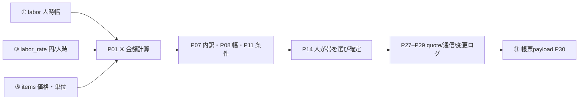

# ④ 金額計算・内訳表示：実装案30件

## 共通前提（① 工数算出エンジン文書の冒頭から転記）

# 役割
あなたは、小規模な自動車整備工場向け業務アプリの設計者です。ハッカソン当日に実装できる範囲で、具体的な実装案を30件設計してください。

# 背景
- 当別町の中小企業DXハッカソン。テーマCは「北海道ならではの自動車修理の工賃を計算する」。
- 対象は家族経営の自動車整備工場。社長がほぼ1人で接客・見積もり・作業をこなしている。
- 現状、工賃は経験と直感で決めている。リース中の見積もりソフトが型式別の標準工数を出すが、北海道の塩カルによる錆、固着、付帯作業、雪下ろしで実際の時間は大きく延びる（1時間の作業が2時間30分になることもある）。
- 塗料やシンナーなどの材料費は社長の入社時から倍になったが、工賃には反映できていない。暖房費や人件費も上がっている。
- 電話で伝えた金額を忘れることがある。PCを使うのは1日1〜2時間（見積書・請求書の作成）で、スマホで選択肢をタップする程度の操作なら問題ない。
- ハッカソンの作業時間は約6時間。まず動くものを作り、そのあと改善する。

# 最初に読むファイル（このリポジトリ内）
- docs/hearing/新規録音 36_文字起こし.txt、37、38（ヒアリング。音声認識の誤りが多いので文脈で読む）
- docs/app-demo/auto_repair_estimate_requirements.md（既存の要件定義。技術構成とSimulatorモードの方針）
- docs/man-hours/README.md（入力辞書、人時の定義、計算規約）
- docs/man-hours/system-ideas-30.md（工数計算方式 S01〜S30 と要因カタログ HK/AG）
- docs/man-hours/data-sources.md（外部データの入手可否）

# MVPの全体像と、システム間の受け渡し
MVPは次の5システムで構成する。
「① 工数算出エンジン → ③ 時間単価 → ④ 金額計算・内訳表示 ← ⑤ 部品・材料単価マスタ → ⑪ 帳票生成」
受け渡しデータはこの形式に合わせる。フィールドを追加するときは理由を書く。
- ①の出力 `labor`: { person_hours: {low, typical, high}, elapsed_hours: {low, typical, high}, breakdown: [{operation, hours, reason, status}], unknowns: [] }
- ③の出力 `labor_rate`: { yen_per_person_hour, effective_from, basis: [{label, value, unit}] }
- ⑤の出力 `items`: [{ item_id, name, category(部品|塗料|溶剤|消耗品), unit, unit_price, price_type(仕入|販売), source, updated_at }]
- ④の出力 `quote`: { lines: [], subtotal, tax, total: {low, typical, high}, reasons: [], confirmed_by, override_reason }
- ⑪は `quote` を受け取り、見積書・請求書を出力する

# 守ること
1. 数値はすべて架空値として明記する。実測値や相場として書かない。
2. 地域・年式・走行距離だけを理由に一律の倍率をかけない。加算は観察した状態と追加工程に対応づける。
3. 未確認の項目を0として扱わず、幅（low/typical/high）か条件付きで示す。
4. 人時と経過時間を分ける。乾燥・融解・部品待ちなどの待機は経過時間にだけ入れる。
5. 暖房費・家賃・人件費は人時に足さず、時間単価の側で扱う。
6. AIや計算の結果は提案にとどめる。確定するのは人で、修正した場合は理由を残す。
7. 外部データの利用規約・契約条件が確認できていないものは「未確認」と書く。スクレイピングを前提にしない。
8. 顧客名や通話音声などの個人情報は最小限にする。
9. 既存資料（S01〜S30など）と同じ内容の案は、新規として数えず既存IDを示す。

# 30案の作り方
- 個別指示の「分類と件数」に従い、30案が偏らないようにする。
- 次のどれか1つ以上が他の案と違う場合だけ別案として数える：データの持ち方／計算方式／操作手順／技術構成／自動化の度合い。
- 常識から外れた案は3〜5件まで含めてよい。その場合は「挑戦案」と明記する。
- 各案に次の項目を書く。
  - ID・名称・一言でいうと
  - 解決する困りごと（録音番号と発言の要旨）
  - 利用者の操作（スマホでの手順とタップ数の目安）
  - 入力／処理（計算式または擬似コード）／出力（上の受け渡し形式に沿う）
  - データの持ち方（テーブル・JSONなどの構造）
  - 技術構成（既存要件定義の構成で当日に使える範囲）
  - 実装の目安（1人で何時間か）
  - 強み／弱み・リスク
  - 必要な外部データと入手可能性（公開／契約／工場提供／架空）

# 出力形式（Markdown 1ファイル）
1. 前提の確認：読んだ根拠と、不明点の一覧
2. 30案の一覧表（ID、名称、分類、一言、実装時間）
3. 各案の詳細
4. 比較評価表：実装時間、現場での使いやすさ、根拠の説明しやすさ、データの入手性、デモでの伝わりやすさを5段階で評価する。作成者による暫定評価と明記する
5. MVPに推奨する3案と、その組み合わせ方。他の4システムとどうつながるかも書く
6. 未確定事項と、整備工場の社長に確認すべき質問

---

本書は①の工数計算規則を再掲せず、`labor`・`labor_rate`・`items`を受けた④の金額計算、見せ方、操作、比較、確定記録を設計する。録音36は経験に頼った電話概算、伝達金額の失念、スマホでの選択操作を支える根拠。録音37は標準工数と実作業の差、錆・固着・付随作業・雪下ろし、時間単価と塗料・シンナーなどの負担を扱う根拠。録音38は参加者による整理・提案であり、社長が確定した方針とは区別する。人時範囲、単価、商品価格、税率例、操作タップ数、実装時間、評価はすべて設計用の架空値で、相場・実測・精度保証ではない。

## 1. 読んだ根拠と不明点

参照した資料は、録音36・37・38、`docs/app-demo/auto_repair_estimate_requirements.md`、`docs/man-hours/README.md`、`docs/man-hours/system-ideas-30.md`、`docs/man-hours/data-sources.md`、および完成済み①設計書の冒頭である。要件定義のReact + TypeScript + Tailwind CSS / FastAPI / SQLite、JSONの初期データ、Simulatorモードを前提にする。Live価格収集や有料データ連携は前提にしない。既存F-05は採用した工賃候補の中央値を参考工賃にするが、本案群では①から人時幅を受け、金額幅を帯ごとに積算して人が帯を選ぶ方式を提案する。既存要件の改定や中央値要件の変更が決定したという意味ではなく、実装時に接続契約を確認する。

④の必須計算規約は次の通り。

- 工賃計算の基礎`H_job_billable[b]`は、案件の条件束ごとに①の実作業工程人時を積み上げ、工場が請求不可として承認した工程だけを除いた請求人時幅とする。除外対象がなければ`H_job_billable[b]=labor.person_hours[b]`。`elapsed_hours`は納期・所要時間の説明専用で、料金に掛けない。`u_period`は本案で適用しない。
- ①の工程行と合計人時は同じ条件束・帯で整合を検査する。low/typical/highが独立した範囲のため、全体幅から除外工程の幅を単純に端同士で引かない。除外工程が同じ条件束にひもづかない、または請求可否・除外人時が未確認なら算出を停止する。条件付きで出す場合は社長が承認した工程・条件幅・理由を明示し、除外人時を0へ補完しない。
- 請求不可工程は①の`labor.breakdown`から消さない。④は内部`billing_selection`へ案件、対象工程、同条件束の人時、除外理由、承認者を保存し、見積行でも由来と「承認済み非請求」を追跡する。この追加記録は①の実作業人時と④の請求人時の差を説明し、未承認控除と二重計上を防ぐため。
- `subtotal` と `tax` は1つの値でなく、`{low, typical, high}` の幅オブジェクトとする。幅ごとの合計・税額を追跡し、幅を中央値1値へ潰さないため。`total`の条件幅は各行の同じbandを積み上げ、条件と根拠を残す。
- 見積行は数量・単位・幅付き金額・`source_system`・`source_ref`・`snapshot`を保持する。①/③/⑤のどの値から作ったかを追い、再計算時の由来を固定し、同じ材料や工程の二重計上を防ぐために追加する。
- `price_type="販売"` の単価はすでに販売価格なので掛率を重ねない。`仕入`の単価は確認済みの承認済み掛率がある場合に限り一度だけ適用する。単位不一致、カテゴリ不正、必須根拠欠落は算出停止とする。
- 不明な作業量・価格・単位を0にしない。関連する必須条件が未確認なら提示額を確定せず停止するか、社長が承認した条件付き幅として表示する。確定時に人が帯を選び、範囲外の上書きには理由を必須とする。
- `communications`は見積本体と別表で管理する。`customer_ref`, `vehicle_ref`, `quote_version`, `selected_band`, `communicated_amount`, `condition_note`, `timestamp`, `operator`を記録し、電話で伝えた金額と前提条件を残す。顧客名・電話番号・通話音声は入れず、架空匿名IDを使う。
- 3タップ電話概算は、作業・工賃レート・対象の販売価格が事前登録され、未確認条件がない場合だけのショートカットとする。いずれかが欠ける場合は質問または停止を表示する。

### 受け渡し型の具体化

入力契約（単位と日付の解釈は工場確認が必要）：

```json
{
  "labor": {
    "person_hours": {"low": 1.0, "typical": 1.5, "high": 2.5},
    "elapsed_hours": {"low": 1.0, "typical": 3.0, "high": 5.0},
    "breakdown": [{"operation": "架空: 固着対応", "hours": {"low": 0.0, "typical": 0.5, "high": 1.0}, "reason": "架空: 現車で固着を観察", "status": "conditional"}],
    "unknowns": []
  },
  "labor_rate": {"yen_per_person_hour": 8000, "effective_from": "2026-10-01", "basis": [{"label": "架空: 工場設定", "value": 8000, "unit": "円/人時"}]},
  "items": [{"item_id": "SIM-PAINT-01", "name": "架空: 塗料", "category": "塗料", "unit": "缶", "unit_price": 1200, "price_type": "仕入", "source": "simulator", "updated_at": "2026-10-11"}]
}
```

本例の数値・ID・日時・材料名はすべて架空の形状例。④の型案：`Range={low:number|null,typical:number|null,high:number|null}`、`line={line_id,kind,description,quantity,unit,unit_price_range,amount_range,source_system,source_ref,snapshot,reason,status}`。見積金額行の幅は上流の幅を保持する。消費税例は仮設定10%・税額円未満切捨てだが、税率・対象区分・端数処理は実装前に最新ルールと工場運用を確認する。

出力契約の拡張案：

```json
{
  "quote": {
    "lines": [{"line_id": "Q-L1", "kind": "labor", "description": "架空: 作業工賃", "quantity": {"low": 1.0, "typical": 1.5, "high": 2.5}, "unit": "人時", "amount": {"low": 8000, "typical": 12000, "high": 20000}, "source_system": "labor_engine", "source_ref": "LAB-EXAMPLE", "snapshot": {"labor": "架空fixture", "labor_rate": "架空fixture", "billing_selection": "架空:全工程請求可"}, "reason": "H_job_billable幅×円/人時"}],
    "subtotal": {"low": 8000, "typical": 12000, "high": 20000},
    "tax": {"low": 800, "typical": 1200, "high": 2000},
    "total": {"low": 8800, "typical": 13200, "high": 22000},
    "reasons": ["架空条件: 部品待ち時間は工賃に含めない"],
    "billing_selection": {"job_ref": "JOB-DEMO-01", "billed_person_hours": {"low": 1.0, "typical": 1.5, "high": 2.5}, "excluded_operations": [], "reason": "架空: 請求不可工程なし", "approved_by": "operator-demo-01", "u_period_applied": false},
    "confirmed_by": "operator-demo-01",
    "override_reason": null,
    "selected_band": "typical",
    "quote_version": 1,
    "status": "proposed"
  }
}
```

`subtotal`/`tax`をrangeにする理由は各帯の根拠を残し、税計算と見積書再生成を再現できるようにするため。`selected_band`, `quote_version`, `status`は人がどの条件幅を選び、何版を提示・確定したかを帳票⑪と通信記録へ一貫して渡すための追加候補。採用前に担当間で型合意する。

## 2. 30案一覧

| ID | 名称 | 分類 | 一言 | 架空の実装時間 |
|---|---|---|---|---:|
| P01 | 請求人時×単価の三帯計算 | 計算 | low/typical/highを同じ帯で積算 | 0.5h |
| P02 | 工程行ごとの工賃組立 | 計算 | 人時根拠を作業別の金額行へ展開 | 0.75h |
| P03 | 単位正規化と不一致停止 | 計算 | 円/人時などの単位を検査 | 0.75h |
| P04 | 仕入掛率の一回適用 | 計算 | 仕入原価から販売額を一度だけ算出 | 0.75h |
| P05 | 値引きの適用順制御 | 計算 | 承認済み値引きの対象・順序を固定 | 0.5h |
| P06 | 最低工賃・最低請求額ルール | 計算 | 最低額を条件付きで適用 | 0.5h |
| P07 | 工賃・部品・材料の分離内訳 | 表示 | 顧客に費目別の由来を見せる | 0.5h |
| P08 | 幅別見積カード | 表示 | 3帯を条件付きで並べる | 0.5h |
| P09 | 税・小計の帯別表示 | 表示 | 各帯ごとに税額・合計を示す | 0.5h |
| P10 | 価格根拠ラベル | 表示 | simulator/工場設定/契約未確認を表示 | 0.5h |
| P11 | 条件・除外事項パネル | 表示 | 未確定条件と追加連絡条件を表示 | 0.5h |
| P12 | スマホ顧客向け要約票 | 表示 | 電話で読める短い説明に整形 | 0.75h |
| P13 | 見積りステップフォーム | 操作 | 入力不足から確定まで誘導 | 0.75h |
| P14 | 帯選択・手動上書き | 操作 | 社長が提案帯を選び理由を残す | 0.5h |
| P15 | 条件変更時の版更新 | 操作 | 入力変更で新しい見積版を作る | 0.75h |
| P16 | 電話中クイック入力 | 操作 | 事前登録済み条件を3タップで呼ぶ | 0.75h |
| P17 | 保存下書きから再開 | 操作 | 中断した見積りの同じ版を開く | 0.75h |
| P18 | 通信記録の手動追記 | 操作 | 伝えた金額と条件を記録 | 0.75h |
| P19 | 即答用作業プリセット | 即答 | よくある作業・条件を一括入力 | 0.75h |
| P20 | 作業名候補の絞込検索 | 即答 | 略称から登録作業を探す | 0.5h |
| P21 | 直近見積りの再提示 | 即答 | 前回の金額を根拠・日付付きで表示 | 0.75h |
| P22 | 不足条件の電話質問ガイド | 即答 | 金額の前に聞く質問を出す | 0.75h |
| P23 | 3帯の条件差比較 | 比較 | 錆・固着等の前提と総額を比較 | 0.75h |
| P24 | 販売単価と仕入単価比較 | 比較 | 出典・更新日付きで品目価格を比べる | 0.75h |
| P25 | 複数作業見積りの統合比較 | 比較 | 作業追加前後の合計と共有費目を比べる | 1.0h |
| P26 | 過去版との変更差分 | 比較 | 変更行・金額・条件を並べる | 0.75h |
| P27 | 確定時スナップショット | 確定ログ | 確定時の入力・単価・計算結果を固定 | 0.75h |
| P28 | 伝達金額・条件の通信台帳 | 確定ログ | 電話で伝えた内容を匿名で追跡 | 0.75h |
| P29 | 追加変更の承認イベント | 確定ログ | 条件発生時の再見積り承認を記録 | 0.75h |
| P30 | ⑪帳票生成向け確定payload | 確定ログ | quoteと由来を帳票へ渡す | 0.75h |

## 3. 各案の詳細

全案のUI・保存はReact + TypeScript + Tailwind CSS / FastAPI / SQLiteで構成し、初期データはJSONまたはSQLiteの架空Simulator fixtureとする。時間は既存の画面・API・DBがある前提の1人作業想定。各案の計算出力は④共通`quote`契約に従う。ここで示す例の値は架空。`labor.breakdown[].hours`がRangeでない旧形式なら、型を確認するまで算出を止める。

### 計算（P01–P06）

#### P01 請求人時×単価の三帯計算
- **一言・録音要旨**：工数幅と単価を同じ帯で掛ける。録音37では標準値と実作業時間のずれ、録音36では経験による電話概算が語られた。
- **スマホ手順**：作業・条件確認→計算（4タップ目安）。幅を見て一帯を選ぶ。
- **入力・式・出力**：同じ条件束の①工程人時を積上げ、承認済み請求不可工程だけを除いた`H_job_billable[b] × labor_rate.yen_per_person_hour`。除外がなければHは`labor.person_hours[b]`と一致する。独立幅の端同士は引かない。工程内訳との不整合、未承認または未知の除外値、単価nullは停止か、社長が承認した条件幅として明示する。工賃行とsubtotal/tax/totalを出し、elapsedと`u_period`は計算に使わない。
- **JSON/データ**：`quote_run{quote_id,labor_snapshot,rate_snapshot,billing_selection,band_amounts,created_at}`。lineは`quantity=H_job_billable幅`, `unit=人時`, sourceは`labor_engine`/`labor_rate`。`billing_selection`にjob、同条件束、除外工程ref、人時、理由、`approved_by`を保存する。
- **技術**：TSの純関数で帯別計算、FastAPI再計算、SQLite snapshot。
- **時間**：0.5h。
- **強み・リスク**：幅の意味を保つ。典型だけを確定額と誤解させない表示が要る。
- **外部データ**：架空Simulatorですぐ用意可。実単価は工場提供・適用日確認待ち。
- **差分・S再利用**：金額層の幅付き換算。S19の人時幅は入力として再利用し、3点人時案の再実装はしない。

#### P02 工程行ごとの工賃組立
- **一言・録音要旨**：工数内訳の各工程を金額明細に変換する。録音37の固着・付随工程の説明に対応。
- **スマホ手順**：内訳を開く→工賃行を確認（3タップ）。
- **入力・式・出力**：同条件束ごとに請求対象工程の`breakdown[i].hours[b]`を積み上げ、`Σ line_amount[b] = H_job_billable[b] × rate`を保つ。請求不可の実作業工程は①の根拠refと理由を内部明細へ残し、承認済みの場合だけ請求額を計上しない。未知・未承認の除外値は停止/明示した承認条件幅とする。同じoperation/source_refの重複行は集約前に警告。
- **JSON/データ**：`quote_line{operation_ref,quantity_range,unit:"人時",amount_range,source_system:"labor_engine",source_ref,snapshot,billing_selection_ref}`。請求不可行も`status:"approved_nonbillable"`、理由、承認者、元の人時範囲を持ち、0円は明示承認された請求上の扱いを表す。請求可能工程の各amountを積み上げた合計はP01の`H_job_billable×rate`と一致させる。
- **技術**：TS reducerとPydantic入出力schema、SQLiteにline snapshot。
- **時間**：0.75h。
- **強み・リスク**：顧客説明しやすい。丸め前の端数をどの行で丸めるか未確定。
- **外部データ**：laborは①入力または架空fixture、実績データ取得なし。
- **差分・S再利用**：行を金額へ変換する責務。S18人時/経過の分離は受け取るだけで、人時の再計算をしない。

#### P03 単位正規化と不一致停止
- **一言・録音要旨**：人時、式、個、缶等が混ざった計算を拒否する。録音37の標準工数・材料費の差を安全に区分。
- **スマホ手順**：不一致バッジ→該当行→正しい単位を選択または確認依頼（3–5タップ）。
- **入力・式・出力**：labor rate unitが円/人時、数量unitがitem.unitと一致したときのみ`qty×unit_price`。不一致はquote status `blocked`、該当amount=null。
- **JSON/データ**：`unit_check{left_unit,right_unit,status,confirmed_by,source_ref}`をquote内部検証ログに保存。
- **技術**：TypeScript enum/unit map、FastAPI validation error、SQLite audit。
- **時間**：0.75h。
- **強み・リスク**：誤った換算を防ぐ。変換可能な単位の辞書を勝手に網羅しない。
- **外部データ**：技術的な外部データなし。工場の請求単位と商品単位は提供確認が必要。
- **差分・S再利用**：工数方式ではなく④の単位ゲート。S30は根拠比較、単位拒否の実装ではない。

#### P04 仕入掛率の一回適用
- **一言・録音要旨**：仕入価格と販売価格を区別し、値上がりした塗料等を透明に計算。録音37の塗料・シンナー費上昇の発言が根拠。
- **スマホ手順**：品目選択→価格区分確認→掛率（仕入時のみ）確認（4タップ）。
- **入力・式・出力**：販売なら`unit_price`; 仕入なら承認済み`markup`がある場合`unit_price×markup`を一度計算。価格タイプが不明、markup未承認、負数は停止。出力理由に適用式を残す。
- **JSON/データ**：`item_price_snapshot{item_id,price_type,base_price,markup,final_unit_price,source,updated_at}`。販売品のmarkupはnull。
- **技術**：TS価格関数、FastAPIで再検証、SQLiteに価格snapshot。
- **時間**：0.75h。
- **強み・リスク**：二重掛率を抑止。粗利方針・掛率の設定権限は未確定。
- **外部データ**：⑤の仕入/販売価格。Simulator用架空商品は用意可。現行価格は工場提供または契約品目で、利用条件未確認。
- **差分・S再利用**：⑤データの価格typeで分岐。S28材料の別建てを入力として使い、材料品目の考え方自体は再掲しない。

#### P05 値引きの適用順制御
- **一言・録音要旨**：値引きを明細か小計に一度だけ適用。録音36の素早い電話提示で暗算を減らす。
- **スマホ手順**：値引き方式→対象行→金額または率→承認（4タップ＋必要なら理由）。
- **入力・式・出力**：承認済み値引きのみ、対象line合計から控除。税計算前後の順序は工場・現行制度の確認後に設定。範囲外率はブロックし、reasonを必須に。
- **JSON/データ**：`discount{scope,line_ids,kind,value,reason,approved_by}`をquote reasonsと監査行に保存。
- **技術**：Pydanticの値引きschema、TS試算、FastAPI保存。
- **時間**：0.5h。
- **強み・リスク**：口頭値引きの計算を再現。値引き権限、税処理順が未確認。
- **外部データ**：外部不要。割引条件は社長が決める。
- **差分・S再利用**：新しい金額調整レイヤー。S20の追加連絡条件は値引きではないため混同しない。

#### P06 最低工賃・最低請求額ルール
- **一言・録音要旨**：小作業にも最低額を適用するか見える化。録音37で人件費・経費と利益が残らない懸念。
- **スマホ手順**：最低額候補→適用対象→適用確認（3タップ）。
- **入力・式・出力**：`labor_charge=max(H_job_billable×labor_rate.yen_per_person_hour, approved_minimum)`。未設定なら通常計算、設定値未承認なら提案のみ。差額を別調整lineとして表示する。
- **JSON/データ**：`minimum_rule{scope,amount,effective_from,approved_by,reason}`をsnapshotへ。
- **技術**：設定JSON、TS max式、FastAPI検証。
- **時間**：0.5h。
- **強み・リスク**：暗黙の底値を見える化。工賃最低額・税対象・適用範囲の社長確認が必要。
- **外部データ**：外部相場不要。工場の価格方針のみ。
- **差分・S再利用**：計算後の工賃政策。S27の時間単価原価計算と重ねて工数へ加算しない。

### 表示（P07–P12）

#### P07 工賃・部品・材料の分離内訳
- **一言・録音要旨**：作業工賃と部品・塗料・溶剤・消耗品を別の小計にする。録音37の材料費上昇と工賃のずれに対応。
- **スマホ手順**：内訳カードを開く→費目を確認（2タップ）。
- **入力・式・出力**：各行kindで集計し`labor_subtotal`, `parts_subtotal`, `materials_subtotal`, `subtotal`のrangeを表示。
- **JSON/データ**：`lines[{kind,category,amount,source_system,source_ref,snapshot}]`。
- **技術**：Reactカード/TS groupBy、FastAPIは集計を再計算。
- **時間**：0.5h。
- **強み・リスク**：何が上がったか説明可能。UIで費目を重複・混同しない工場確認が必要。
- **外部データ**：Simulator架空品目。実価格は⑤の提供データ、取得条件は未確認。
- **差分・S再利用**：既存要件F-05の分離要件に沿った詳細行UI。S28の材料別建てを再実装せず、⑤行を表示する。

#### P08 幅別見積カード
- **一言・録音要旨**：low/typical/highを並べ、各帯の前提条件を選べるようにする。録音37の不確実な固着・付帯作業に対応。
- **スマホ手順**：3カードを見る→条件を読む→1帯を選ぶ（4タップ目安）。
- **入力・式・出力**：`total.low/typical/high`の各値と対応理由をカード化。条件なしの確定単額を自動選択しない。
- **JSON/データ**：`band_cards[{band,amount,condition_refs,selected}]`はquote snapshotから導出。
- **技術**：レスポンシブReact cards、TS band mapper。
- **時間**：0.5h。
- **強み・リスク**：幅が見やすい。典型値を実測中央値と誤解させない文言が必要。
- **外部データ**：外部不要。幅は①/③/⑤の架空または提供値。
- **差分・S再利用**：S19は人時側の3点見積もり。本案は円額の選択UIと条件表示。

#### P09 税・小計の帯別表示
- **一言・録音要旨**：各帯の税額を独立計算して合計する。録音36の即答額を一貫した計算にする。
- **スマホ手順**：税区分確認→3帯を表示（2–3タップ）。
- **入力・式・出力**：仮例`tax[b]=floor(taxable_subtotal[b]×configured_rate)`。税率・対象・端数設定が未確認ならSimulator表記または確定停止。帯ごとにsubtotal/tax/totalを表示。
- **JSON/データ**：`tax_snapshot{rate,rounding,taxable_line_ids,effective_date,source}`。
- **技術**：Decimal計算をTS/FastAPIで同じ仕様にし、backendを正とする。
- **時間**：0.5h。
- **強み・リスク**：差額と端数の説明が可能。最新税区分・工場運用を実装直前に確認する。
- **外部データ**：制度の現行確認が必要。架空例10%はデモ用だけで本番既定にしない。
- **差分・S再利用**：F-05に税額計算はあるが幅別subtotal/tax保持はないため、今回は範囲追跡を追加。

#### P10 価格根拠ラベル
- **一言・録音要旨**：各金額の出所・取得日・価格区分を明示。録音37では値上がりをネット等で確認する発言。
- **スマホ手順**：価格ラベル→出典詳細（1–2タップ）。
- **入力・式・出力**：金額計算は変えず、各行に`source_system/source_ref/snapshot/updated_at/price_type`を表示。出所なしを「確認済」と表現しない。
- **JSON/データ**：`source_badge{system,ref,updated_at,price_type,fictional}`。
- **技術**：TS label renderer、FastAPI schema要求。
- **時間**：0.5h。
- **強み・リスク**：架空と実価格の混同を防ぐ。source URLを顧客へ出す場合の許諾は別確認。
- **外部データ**：公開・契約・工場提供・Simulatorを区別。スクレイピング前提なし。
- **差分・S再利用**：S29説明票とは画面内の項目レベルの出所表示が差分。S30の方式列比較を再掲しない。

#### P11 条件・除外事項パネル
- **一言・録音要旨**：金額の前提、未確認条件、追加連絡条件を固定表示。録音37の分解後追加作業、録音38の整理議論。
- **スマホ手順**：条件を確認→必要なら編集→了承状態を記録（3タップ）。
- **入力・式・出力**：`labor.unknowns`, conditional breakdown, 除外工程をreasonへ集約。未知条件をゼロ計上に変換しない。
- **JSON/データ**：`conditions[{text,source_ref,status,customer_ack_required}]`。社長承認と顧客了承を別状態。
- **技術**：React disclosure panel、SQLite conditions。
- **時間**：0.5h。
- **強み・リスク**：条件を口頭で漏らしにくい。顧客合意の法的十分性は保証せず、文言は工場確認。
- **外部データ**：外部不要。状態・追加工程は現車確認または①の入力。
- **差分・S再利用**：S20条件付き見積を利用するが、ここでは④画面に条件と除外を集約して表示。

#### P12 スマホ顧客向け要約票
- **一言・録音要旨**：顧客へ口頭で短く伝える工賃・材料・条件の要約を作る。録音36の電話対応、録音37の費用説明。
- **スマホ手順**：要約プレビュー→コピーまたは読み上げ（2–3タップ）。
- **入力・式・出力**：selected_bandと理由を短文へ整形。未確認項目が残る場合は「条件確認後に確定」と出す。
- **JSON/データ**：`summary_snapshot{quote_version,band,amount,condition_note,generated_at}`。
- **技術**：React text renderer、SQLiteに生成版参照を保存。
- **時間**：0.75h。
- **強み・リスク**：電話中に説明しやすい。自動生成文が確定額や保証と誤認されない確認が要る。
- **外部データ**：外部不要。Simulator用の文章だけ。
- **差分・S再利用**：S29の顧客向け説明シートは写真等を含む帳票案。本案はスマホ電話用の短文。

### 操作（P13–P18）

#### P13 見積りステップフォーム
- **一言・録音要旨**：車両・作業・根拠・計算・確定を段階表示。録音36のスマホタップ利用意向。
- **スマホ手順**：車両→作業→条件→金額→確定（5画面、架空目安8タップ）。
- **入力・式・出力**：不足チェックを通過したときだけ次画面へ。最終的にquoteを作る。
- **JSON/データ**：`draft{step,input_refs,validation_state,updated_at}`。
- **技術**：React stepper、FastAPI draft API、SQLite下書き。
- **時間**：0.75h。
- **強み・リスク**：作業順を覚えなくてよい。初回の入力項目過多は社長と検証。
- **外部データ**：外部不要。車両/品目はSimulator fixtureを使用可能。
- **差分・S再利用**：F-01〜F-06の流れを金額計算の入力不足ゲートとして具体化。S16質問工程の再掲ではない。

#### P14 帯選択・手動上書き
- **一言・録音要旨**：担当者が提案帯を選択し、範囲外変更には理由を付ける。録音36で社長の直感概算、録音37で価格判断。
- **スマホ手順**：帯選択→金額編集→理由→確認（4タップ＋理由入力）。
- **入力・式・出力**：選択金額は帯の値。範囲外なら`override_reason`必須。確定者・旧額・新額を保持。
- **JSON/データ**：`confirmation{selected_band,proposed_range,final_amount,confirmed_by,override_reason,confirmed_at}`。
- **技術**：React numeric keypad、FastAPI server validation、SQLite audit row。
- **時間**：0.5h。
- **強み・リスク**：最終決定権を人に置ける。誤タップ対策と責任者選定は必要。
- **外部データ**：外部不要。確認者は工場提供の運用設定。
- **差分・S再利用**：S12の補正値更新ではなく、個別quoteの最終額決定。

#### P15 条件変更時の版更新
- **一言・録音要旨**：条件を変更すると新versionを作り、旧versionを残す。録音37の状態変化と録音36の前回金額忘却。
- **スマホ手順**：保存済み見積→条件変更→差分→新版保存（4タップ）。
- **入力・式・出力**：編集後に④を全再計算し`quote_version=n+1`。古い版の通信記録は旧額のまま。
- **JSON/データ**：`quote_versions{quote_id,version,parent_version,input_snapshot,quote_snapshot,created_at}`。
- **技術**：FastAPI transactional insert、SQLite immutable versions。
- **時間**：0.75h。
- **強み・リスク**：後から「何を伝えたか」を再現。不要な改版を増やさない操作設計が要る。
- **外部データ**：外部不要。上流スナップショットだけ。
- **差分・S再利用**：S09の同一車両履歴とは別に、見積書の版を不変保存。

#### P16 電話中クイック入力
- **一言・録音要旨**：登録済み内容を3タップで呼び出す。録音36の電話で即答する経験依存と金額忘却。
- **スマホ手順**：作業プリセット→車両区分→計算（3タップ）。成立条件は品目・レート・条件を事前登録済みで、必須確認がないこと。
- **入力・式・出力**：プリセット参照後、P01〜04の計算。対象車・固着等が未確認なら幅付き仮提示か停止。登録済み値を現在値と誤認しない。
- **JSON/データ**：`quick_preset{preset_id,job_ref,rate_ref,item_refs,conditions_required,updated_at}`。
- **技術**：TS lookup、FastAPI quote run、SQLite preset。
- **時間**：0.75h。
- **強み・リスク**：電話中の入力を減らす。3タップだけで無条件の確定額を出す設計にしない。
- **外部データ**：架空presetは可。実レート・販売価格は工場確認。
- **差分・S再利用**：新しいショートカット導線。S16の質問分岐とは作業入力を一括選択する点が違う。

#### P17 保存下書きから再開
- **一言・録音要旨**：接客中に中断した計算を元の入力から再開。録音36の社長一人で接客・作業を行う状況。
- **スマホ手順**：下書き一覧→1件選択→続きから（2タップ）。
- **入力・式・出力**：snapshot時点の価格は再利用しない。再開時に「現在価格で更新」か「当時価格のまま編集」を担当者選択し、selected modeを残す。
- **JSON/データ**：`draft{draft_id,input_refs,price_snapshots,paused_at,resume_mode}`。
- **技術**：SQLite draft persistence、FastAPI resume endpoint。
- **時間**：0.75h。
- **強み・リスク**：接客中断でも入力を失わない。古い単価が現行と誤認される恐れに日付バッジを付ける。
- **外部データ**：外部不要。単価更新は⑤の契約/工場/fixture。
- **差分・S再利用**：S09履歴検索でなく未確定の作業状態の再開。

#### P18 通信記録の手動追記
- **一言・録音要旨**：伝えた金額・帯・条件を一操作で記録。録音36の電話で前回金額を忘れる課題。
- **スマホ手順**：見積版→「電話で伝えた」→金額帯・条件確認（3タップ）。通話録音・自動録音はしない。
- **入力・式・出力**：選択金額とcondition noteを通信表へ追記。quote自体は変更しない。
- **JSON/データ**：`communication{customer_ref:"C-DEMO-01",vehicle_ref:"V-DEMO-01",quote_version:1,selected_band:"typical",communicated_amount:13200,condition_note:"架空:現車確認後に再確定",timestamp,operator}`。値は架空。
- **技術**：React quick action、FastAPI insert-only endpoint、SQLite communications。
- **時間**：0.75h。
- **強み・リスク**：誰が何を伝えたか確認可能。匿名refの運用と誤記訂正方法を決める。
- **外部データ**：外部不要。架空匿名IDで試作。
- **差分・S再利用**：S25の音声入力案と異なり、音声を取得せず人が記録内容を選ぶ。

### 即答（P19–P22）

#### P19 即答用作業プリセット
- **一言・録音要旨**：頻出作業の項目を事前登録して入力を短縮。録音36の即時概算とタップ操作。
- **スマホ手順**：作業・車格・同時作業のプリセット選択（2–3タップ）→条件の不足だけ確認。
- **入力・式・出力**：bundle内のjob/rate/itemsでP01〜04計算。価格snapshotが期限切れなら注意表示と更新確認。
- **JSON/データ**：`preset{id,job_ref,default_quantity,required_conditions,rate_ref,item_refs,version}`。
- **技術**：Simulator JSONを読み、FastAPIで照合・再計算。
- **時間**：0.75h。
- **強み・リスク**：毎回入力を減らせる。車種・状態を固定とみなさない。
- **外部データ**：作業・品目は架空作成可、現実のセット内容は工場提供。
- **差分・S再利用**：個別quote用の選択可能テンプレート。S15工程分岐の計算規則を持たない。

#### P20 作業名候補の絞込検索
- **一言・録音要旨**：電話で聞いた作業名から登録jobを検索。録音36の口頭即答場面。
- **スマホ手順**：略称を検索→候補選択→確認（3タップ）。
- **入力・式・出力**：入力語から許可済みalias一覧を検索。候補が曖昧なら選択させ、価格は選択後に計算。
- **JSON/データ**：`job_alias{alias,job_id,source:"factory",approved_by}`。
- **技術**：React filter、SQLite indexed alias、FastAPI GET.
- **時間**：0.5h。
- **強み・リスク**：正式名が分からなくても探せる。曖昧一致で別作業を確定しない。
- **外部データ**：外部不要。工場の通称は聞き取りが必要。
- **差分・S再利用**：作業検索UXのみ。S08の類似実績検索は行わない。

#### P21 直近見積りの再提示
- **一言・録音要旨**：似た条件の前回quoteを電話中に見つける。録音36で前に何円と言ったか忘れる、録音37でPCに過去見積りがある。
- **スマホ手順**：匿名顧客/車両ref検索→過去quote確認→今回条件を再確認（3–5タップ）。
- **入力・式・出力**：前回額をそのまま現在額として使わず、前回snapshot、価格日、条件差を表示。再利用は別版の再計算とする。
- **JSON/データ**：`quote_search{customer_ref,vehicle_ref,job_ref,version,created_at,amount_snapshot,condition_snapshot}`。
- **技術**：SQLite query、FastAPI search endpoint、React result list。
- **時間**：0.75h。
- **強み・リスク**：同じ顧客の説明を追いやすい。個人識別を最小にし、顧客名なしでも検索できる運用が必要。
- **外部データ**：工場過去記録の提供形式は未確認。架空履歴でのみデモ。
- **差分・S再利用**：S09は車両状態の経年履歴。本案は旧金額の参照を優先し、現車状態を再利用しない。

#### P22 不足条件の電話質問ガイド
- **一言・録音要旨**：金額計算の前に聞くべきことを短い質問で示す。録音36のスマホ操作、録音37の状態差。
- **スマホ手順**：作業選択→質問カード→回答または不明を選ぶ→試算（4タップ目安）。
- **入力・式・出力**：required_fieldsが未入力なら質問を生成。関連必須が不明ならstop、社長承認済み条件幅があればconditional quote。
- **JSON/データ**：`question{field,prompt,answer,status,source_ref}`。
- **技術**：JSON question schema、React cards、FastAPI validator。
- **時間**：0.75h。
- **強み・リスク**：必要事項を聞き漏らしにくい。質問が増えすぎると電話の負担。
- **外部データ**：外部不要。質問と作業の対応は社長・整備士の提供確認が必要。
- **差分・S再利用**：S16質問形式の工数展開ではなく、金額算出の必須情報と連絡条件に限定。

### 比較（P23–P26）

#### P23 3帯の条件差比較
- **一言・録音要旨**：low/typical/highの金額だけでなく成立条件を横並びにする。録音37の錆・固着の不確実性。
- **スマホ手順**：カード切替→条件を比較→選ぶ（3タップ）。
- **入力・式・出力**：各bandに紐づく工程と材料の差を比較し、価格変化寄与を表示。条件のない差額説明は出さない。
- **JSON/データ**：`band_comparison[{band,amount,condition_refs,line_ids}]`。
- **技術**：TS diff renderer、quote snapshotから算出。
- **時間**：0.75h。
- **強み・リスク**：顧客へ幅の理由を話しやすい。帯ごとの条件は整備士承認が要る。
- **外部データ**：外部不要。条件は①、品目単価は⑤。
- **差分・S再利用**：S19は人時の3点見積。P23は金額構成の差を並べる。S30のA/B/C方式横比較ではない。

#### P24 販売単価と仕入単価比較
- **一言・録音要旨**：材料ごとの仕入・販売単価と更新日を見比べる。録音37の材料価格上昇。
- **スマホ手順**：品目→仕入/販売タブ→価格履歴（3タップ）。
- **入力・式・出力**：異なるprice_typeを区別し、仕入値に掛率がある場合の計算案を表示。選択中の販売値に再掛率しない。
- **JSON/データ**：`item_price_history{item_id,price_type,unit,unit_price,source,updated_at}`。
- **技術**：SQLite history table、FastAPI list、React comparison view。
- **時間**：0.75h。
- **強み・リスク**：値上がりの由来を追いやすい。価格履歴・提供権限は未確認。
- **外部データ**：⑤の工場提供または許諾済み価格。公開価格取得は今回のMVPに入れない。
- **差分・S再利用**：P04は1価格の販売額計算。本案は複数価格snapshotの比較。

#### P25 複数作業見積りの統合比較
- **一言・録音要旨**：複数作業を同時に頼む前後で小計を比較し、同じ部品・材料を重複計上しない。録音37の複数付帯作業の懸念。
- **スマホ手順**：作業追加→統合内訳→重複候補を承認（4–6タップ）。
- **入力・式・出力**：各job lineを合算。同じitem_id/usage_refの重複は候補表示し、人が採用する。自動控除はしない。
- **JSON/データ**：`quote_group{job_refs,line_ids,shared_item_candidates,accepted_dedup_refs}`。
- **技術**：TS aggregate、FastAPI validation、SQLite quote lines。
- **時間**：1.0h。
- **強み・リスク**：一括依頼の材料重複に気づける。共通工程と材料の範囲・数量を混同しない。
- **外部データ**：既存jobと⑤itemが必要。架空fixtureのみ当日可。
- **差分・S再利用**：S17は共有作業工程の工数重複排除。本案は材料/請求行の二重登録確認で、S17処理はしない。

#### P26 過去版との変更差分
- **一言・録音要旨**：条件や品目が変わった見積りの行差・金額差を示す。録音36の電話金額記憶、録音37の価格変化。
- **スマホ手順**：旧版/新版選択→差分表示（2–3タップ）。
- **入力・式・出力**：line_idまたはsource_refで追加・削除・変更を分類し、band別差額を計算。元版は不変。
- **JSON/データ**：`quote_diff{from_version,to_version,added,removed,changed,amount_delta}`。
- **技術**：TS diff pure function、SQLite version snapshots。
- **時間**：0.75h。
- **強み・リスク**：電話口で変わった理由を簡潔に説明。異なる条件の額を単純比較しない。
- **外部データ**：過去quoteは工場提供または架空履歴。
- **差分・S再利用**：E12差分再計算は工数内部の再計算、本案はquote版の表示比較。

### 確定ログ（P27–P30）

#### P27 確定時スナップショット
- **一言・録音要旨**：確定時点の全計算材料を保存。録音36の伝達額忘却と録音37の単価変動。
- **スマホ手順**：最終確認→確定（2タップ）。
- **入力・式・出力**：quote lines, subtotal/tax/total ranges, selected band, labor/rate/items snapshots, reasonsをtransactionで保存。
- **JSON/データ**：`quote_snapshot{quote_id,version,inputs,lines,subtotals,tax,total,confirmed_by,confirmed_at}`。
- **技術**：FastAPI transaction、SQLite immutable JSON snapshot。
- **時間**：0.75h。
- **強み・リスク**：後日同じ明細を再現可能。個人情報・スナップショット肥大化を避ける。
- **外部データ**：外部不要。外部ソース参照は許諾範囲と取得日を保存。
- **差分・S再利用**：E02版付きルールの保存対象は①内部規則。本案は④の確定商談単位。

#### P28 伝達金額・条件の通信台帳
- **一言・録音要旨**：電話で実際に伝えた額と帯・条件を見積りversionに結ぶ。録音36が直接の根拠。
- **スマホ手順**：通信記録→帯・金額確認→保存（3タップ）。
- **入力・式・出力**：communicationsへ`customer_ref,vehicle_ref,quote_version,selected_band,communicated_amount,condition_note,timestamp,operator`をappend-onlyで保存。顧客名・電話番号・音声なし。
- **JSON/データ**：通信台帳はquoteと分離したSQLite table。参照IDは架空匿名ID。
- **技術**：FastAPI POST、SQLite FKでquote version参照、React quick action。
- **時間**：0.75h。
- **強み・リスク**：前に伝えた金額を見返せる。匿名ref発番と閲覧権限は未確定。
- **外部データ**：外部不要。架空通信記録でデモ可。
- **差分・S再利用**：S25音声メモは採用しない。S29の顧客説明票とも異なり、対外送信記録を保存する。

#### P29 追加変更の承認イベント
- **一言・録音要旨**：分解後に追加費用が出る場合、変更条件と顧客への連絡をイベントとして記録。録音37の付随破損、録音36の電話忘れ。
- **スマホ手順**：追加工程選択→再計算→連絡済/未連絡→承認記録（4タップ）。
- **入力・式・出力**：追加lineを新quote versionに加え、旧通信内容を保持。顧客合意未記録なら作業継続判断を`pending`表示し確定済みとしない。
- **JSON/データ**：`change_event{quote_id,from_version,to_version,trigger_ref,delta_lines,communicated_amount,condition_note,operator,timestamp,ack_status}`。
- **技術**：FastAPI transaction + SQLite append event、React timeline。
- **時間**：0.75h。
- **強み・リスク**：追加の経緯を追える。顧客合意の法的な扱いはこの機能だけで保証しない。
- **外部データ**：外部不要。現車観察・整備士入力は工場提供。
- **差分・S再利用**：S20は追加発生時条件の事前提示。本案は発生後のquote変更・通信状態ログ。

#### P30 ⑪帳票生成向け確定payload
- **一言・録音要旨**：確定済みquoteを⑪が再計算せず帳票化できる形式に固定。録音38の参加者整理にある見積りから帳票への流れに対応。ただし社長確定事項ではない。
- **スマホ手順**：確定quote→帳票プレビュー→⑪へ出力（3タップ）。
- **入力・式・出力**：`status=confirmed`かつselected_band/confirmed_byが揃ったquoteのみ渡す。⑪はamountを再計算せず受け取り、版・条件・由来を併記する。
- **JSON/データ**：`quote_document_payload{quote_id,quote_version,lines,subtotal,tax,total,selected_band,reasons,conditions,confirmed_by,override_reason,sources}`。
- **技術**：FastAPI response schema、SQLite quote snapshot。帳票生成自体は⑪の担当。
- **時間**：0.75h。
- **強み・リスク**：④と帳票の金額差を防ぐ。帳票書式・税表示・顧客表示項目は⑪と合意が必要。
- **外部データ**：外部不要。Simulatorで固定payloadを渡せる。
- **差分・S再利用**：既存要件は将来のPDF出力を記載。本案はその前段の確定API契約と改変防止。

## 4. 30案の比較評価（作成者による暫定評価）

1＝低い/難しい、5＝高い/容易。実装時間は短いほど高得点、他軸は高いほど有利。社長・整備士による評価、実装時間計測、現場検証は未実施。全点数と金額例は設計上の仮評価。

| ID | 案名 | 時間 | 現場使いやすさ | 説明しやすさ | データ入手性 | デモ伝達性 |
|---|---|---:|---:|---:|---:|---:|
| P01 | 請求人時×単価の三帯計算 | 5 | 4 | 5 | 4 | 5 |
| P02 | 工程行ごとの工賃組立 | 4 | 4 | 5 | 4 | 5 |
| P03 | 単位正規化と不一致停止 | 4 | 3 | 5 | 4 | 4 |
| P04 | 仕入掛率の一回適用 | 4 | 4 | 5 | 3 | 5 |
| P05 | 値引きの適用順制御 | 5 | 4 | 4 | 4 | 3 |
| P06 | 最低工賃・最低請求額ルール | 5 | 3 | 4 | 3 | 3 |
| P07 | 工賃・部品・材料の分離内訳 | 5 | 5 | 5 | 4 | 5 |
| P08 | 幅別見積カード | 5 | 5 | 5 | 4 | 5 |
| P09 | 税・小計の帯別表示 | 5 | 4 | 4 | 4 | 4 |
| P10 | 価格根拠ラベル | 5 | 4 | 5 | 4 | 5 |
| P11 | 条件・除外事項パネル | 5 | 4 | 5 | 4 | 5 |
| P12 | スマホ顧客向け要約票 | 4 | 5 | 4 | 4 | 5 |
| P13 | 見積りステップフォーム | 4 | 5 | 4 | 4 | 4 |
| P14 | 帯選択・手動上書き | 5 | 5 | 5 | 4 | 5 |
| P15 | 条件変更時の版更新 | 4 | 4 | 5 | 4 | 4 |
| P16 | 電話中クイック入力 | 4 | 5 | 4 | 3 | 5 |
| P17 | 保存下書きから再開 | 4 | 4 | 3 | 4 | 3 |
| P18 | 通信記録の手動追記 | 4 | 5 | 5 | 4 | 5 |
| P19 | 即答用作業プリセット | 4 | 5 | 4 | 3 | 5 |
| P20 | 作業名候補の絞込検索 | 5 | 4 | 3 | 4 | 3 |
| P21 | 直近見積りの再提示 | 4 | 4 | 4 | 2 | 4 |
| P22 | 不足条件の電話質問ガイド | 4 | 4 | 5 | 3 | 4 |
| P23 | 3帯の条件差比較 | 4 | 4 | 5 | 4 | 5 |
| P24 | 販売単価と仕入単価比較 | 4 | 3 | 5 | 2 | 4 |
| P25 | 複数作業見積りの統合比較 | 3 | 3 | 4 | 3 | 4 |
| P26 | 過去版との変更差分 | 4 | 4 | 4 | 3 | 4 |
| P27 | 確定時スナップショット | 4 | 3 | 5 | 4 | 4 |
| P28 | 伝達金額・条件の通信台帳 | 4 | 5 | 5 | 4 | 5 |
| P29 | 追加変更の承認イベント | 4 | 3 | 5 | 4 | 4 |
| P30 | ⑪帳票生成向け確定payload | 4 | 3 | 5 | 4 | 4 |

## 5. MVPに推奨する3案と接続

### 推奨：P01 + P07 + P14（6時間の最小切り出し）

架空fixtureで「作業選択→請求人時三帯×時間単価→費目別内訳→担当者が帯を選び確定」までを動かす。P01は計算核（請求不可工程がない架空例として、1.0/1.5/2.5人時×架空8,000円/人時）、P07は工賃・部品・材料を混ぜない内訳、P14は人の選択と修正理由を実演する。請求不可工程を含む場合は同条件束の人時を使い、承認済み除外だけを反映する。税は既存F-05の設定値をSimulator限定で使い、税率・丸めを本番値と主張しない。P08幅カード、P10根拠ラベル、P11条件表示は同じ画面の必須表示として最小実装し、別機能として広げない。

| 経過 | 切り出し | 完了イメージ |
|---|---|---|
| 0–1h | TS quote計算型・range schema・架空fixture | 人時/単価/品目の型を検証 |
| 1–2.5h | P01・P07のFastAPI/TS計算 | 工賃と品目行、帯別subtotal/tax/totalを返す |
| 2.5–4h | スマホ内訳カード・帯選択 | 3帯と費目を画面に表示 |
| 4–5h | P14確認・上書き理由・snapshot保存 | confirmed_by/override_reasonをSQLiteへ保存 |
| 5–6h | 入力不足・二重掛率・単位不一致を画面表示 | 正常/停止のデモシナリオを切替 |

この時間割は一人・既存React/FastAPI/SQLiteひな型が動く前提の架空計画。環境構築、PDF、Live API、既存ソフト連携、価格マスタ作成、複数作業の自動重複控除、音声保存、認証、実車試験を含まない。

### 5システム接続

①は人時幅・工程根拠・unknownsを出し、③は適用日付き円/人時を出す。④のP01が同じbandごとに工賃を計算する。⑤は品目単位・価格type・価格出所・更新日を渡し、P04ルールに従い二重掛率を拒否する。P07で費目を分け、P14で担当者が帯を選び確定。⑪へはP30のquote snapshotを渡し、帳票側で再計算しない。`subtotal`, `tax`, `total`は幅のまま保持し、確定額と通信額は`selected_band`とversion参照でつなぐ。



## 6. 未確定事項・社長への質問

1. `labor.person_hours` と既存ソフトの作業点数・工数の定義、含有工程はどう対応するか。人時でない入力を④が扱う必要はあるか。
2. 工場の請求人時単価、適用開始日、時間単位、端数処理と改定担当者は誰か。
3. 低・標準・高のどの幅を電話で案内し、見積書で確定するのか。「typical」は社長の経験中央値を意味するのか。
4. 未確認条件を含む場合、概算として条件付きで伝えるのか、確認完了まで金額提示を止めるのか。
5. 部品・塗料・溶剤・消耗品の数量と単位、販売価格または仕入価格のどちらを登録するか。仕入価格へ掛率を適用するなら誰が率を決め、いつ見直すか。
6. 仕入品と販売品を同時に使う場合の二重掛率を、どの登録規則で防ぐか。
7. 値引き・最低工賃・最低請求額を使うか。対象、上限、税計算前後、承認者はどうするか。
8. 消費税率、課税対象、端数処理は要件定義のSimulator例から本番設定へ移す前に誰が確認するか。
9. 見積りで顧客へ伝える条件、追加発生時の連絡・承認記録は何を残せばよいか。
10. 顧客・車両の匿名refを誰が管理し、通信記録を誰がどれだけの期間見られるか。
11. ⑤の材料価格に更新日・出典・提供許諾をどの形式で付けられるか。既存ソフトやFAINESからの外部アプリ利用条件は確認できているか。
12. 録音38に出た案のうち、参加者の提案と社長の決定を誰が分けて確認するか。

公開ページの確認は入手可能性を意味しない。公開価格・有料データ・FAINES・既存ソフトのアプリ組込み、再配布、API利用条件は未確認。公開相場のスクレイピングは設計前提にせず、当日デモはSimulatorの架空商品・架空価格のみで構成する。
